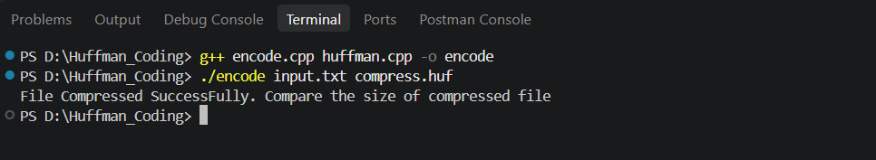
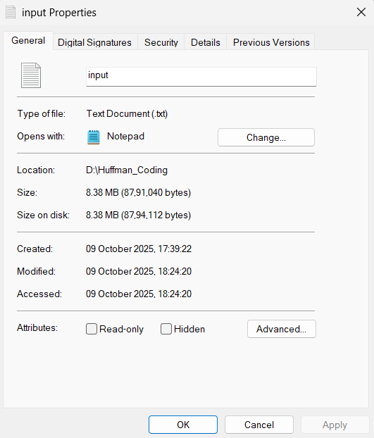
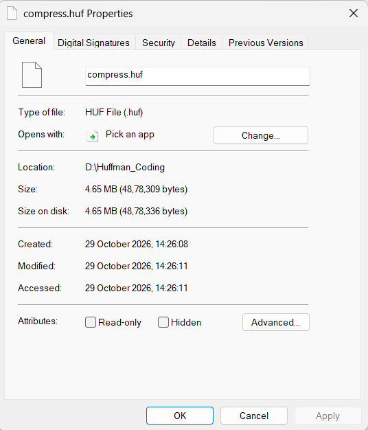
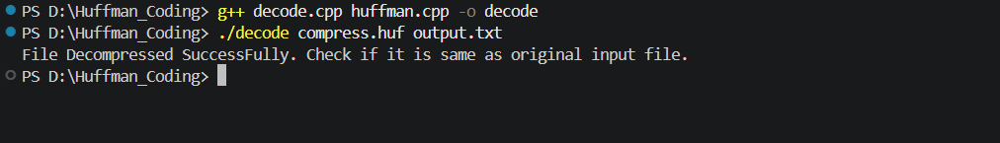
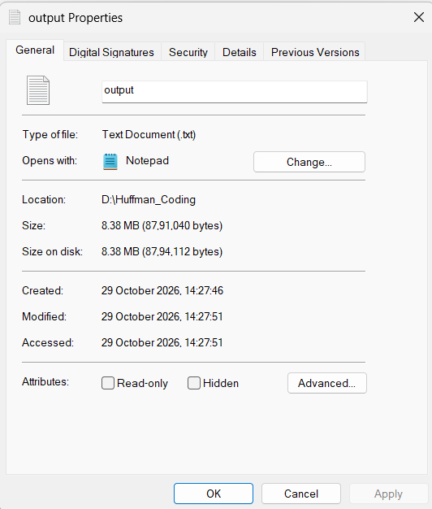
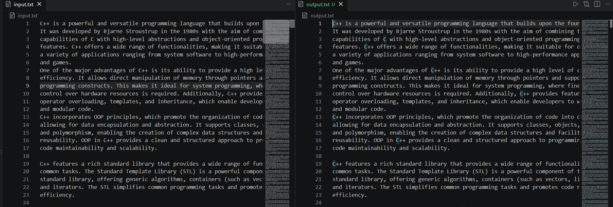

# Huffman Coding

Huffman Coding is a lossless compression technique used to reduce the size of files without losing any data. It assigns shorter codes to frequently occurring characters and longer codes to less frequent characters, helping reduce the overall file size.

## How to Run the Code

1. Clone the repository to your local machine and navigate to the project directory.

2. **Compress the file**

   Run the compression command to compress the input file.

   

3. **Compare the input and compressed file sizes**

   Check the size of the original input file and the compressed file. The compressed file size can be compared with the original to observe the reduction in file size.

   **Input File Size**

   

   **Compressed File Size**

   

4. **Decompress the file**

   Run the decompression command to recover the original file from the compressed file.

   

5. **Check the output file size**

   After decompression, check the size of the output file and compare it with the original input file.

   

6. **Compare the input and output files**

   Finally, compare the contents of the original input file and the decompressed output file to verify that the data has been restored correctly without any loss.

   
